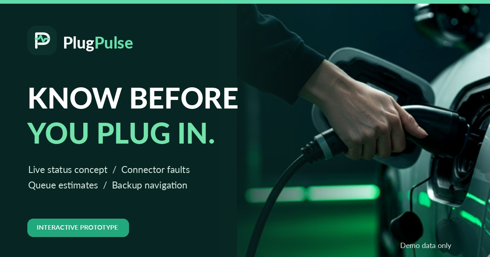

# PlugPulse — EV Charger Verification Prototype

**Know before you charge.** PlugPulse is a mobile-friendly, interactive concept designed to help electric vehicle drivers make more informed charging-stop decisions.

### [Explore the live PlugPulse prototype](https://nilabjo08.github.io/PlugPulse/)

> **Prototype notice:** PlugPulse is a concept demonstration, **not a live EV charging service**. The stations, connector availability, faults, queue times, routes, and alerts shown in the demo use fictional or simulated data. There are no live charging-network integrations or real-time verified charger feeds.

## The problem

A charging station listed as available may be occupied, out of service, inaccessible, or reporting outdated status. Drivers can lose time and battery range travelling to a charger they cannot use.

## The proposed solution

PlugPulse explores a simpler way to **check charger status and confidence before setting off**. The prototype demonstrates:

- **Charger discovery:** Explore nearby sample stations, search, and filter options.
- **Connector-level information:** See illustrative availability and reported charger faults.
- **Data freshness:** Understand when a station's simulated status was last updated.
- **Queue estimates:** View illustrative waiting-time ranges rather than guaranteed slots.
- **Alternative routes:** Simulate a charger becoming unavailable during a journey and switch to a backup.
- **Driver reporting:** Submit a sample fault report, marked *unverified* and kept only for the current session.
- **Responsive design:** Try the experience on desktop, tablet, or mobile browsers.

## Try the demo

1. Open **[PlugPulse](https://nilabjo08.github.io/PlugPulse/)**.
2. Browse the charger explorer; use station search, filters, or map pins.
3. Select a station to view connectors, fault indicators, and sample wait estimates.
4. Select **Plan a route**, start the demo journey, and simulate an unavailable charger.
5. Try the **Report a problem** flow and other interactive controls.

The map and navigation experience are demonstrations; they do not provide real directions to working public chargers.

## Technology and hosting

- **Frontend:** Static HTML, CSS, and JavaScript.
- **Hosting:** GitHub Pages, published from the `main` branch and repository root.
- **Assets:** Local logos and illustrations, an EV charging photo, and some externally hosted background photography.
- **Current backend:** None. No account, API key, or application installation is needed to view the demo.

### Publish or update using GitHub Pages

1. Keep `index.html` at the root of this repository, with `assets/` alongside it.
2. In GitHub, open **Settings → Pages**.
3. Under **Build and deployment**, choose **Deploy from a branch**, branch **`main`**, folder **`/(root)`**.
4. Save the settings. Once deployment succeeds, the public website is:
   **https://nilabjo08.github.io/PlugPulse/**
5. To update the site, commit changed website files to `main` and check the Pages deployment status under **Actions**.

## Current limitations

This is a proof of concept using simulated information. **It does not currently provide live charger availability, guaranteed queue times, working reservations, payments, push notifications, live road navigation, or persistent user reports.** Do not use the demonstration to choose an actual charging stop.

## Roadmap

The next development stage is to explore:

1. Authorized charging-network integrations, such as operator APIs / OCPI feeds, for genuinely current charger status.
2. Reliability checks for status freshness and charger functionality.
3. Real routing services and compatible alternative charging locations.
4. A secure backend to collect, moderate, verify, and retain driver reports.
5. Queue predictions informed by reliable session and occupancy data, with clear uncertainty ranges.
6. Pilot testing with EV drivers and charging operators before offering the service for real journeys.

## Feedback and collaboration

PlugPulse is being shared publicly to demonstrate the idea and collect feedback from **EV drivers, charging-station operators, EV startups, developers, and mobility professionals**.

Have you reached a public charger only to find it broken or occupied? Which information would have helped you avoid the trip?

Share your suggestions through this repository's **[Issues](https://github.com/nilabjo08/PlugPulse/issues)** section (if enabled). Please avoid including personal contact details or vehicle information in public issue reports.

---

**PlugPulse** · An interactive EV charging reliability concept · [Live prototype](https://nilabjo08.github.io/PlugPulse/)
